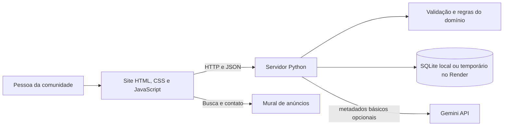

# CESMAC Achados & Perdidos

Aplicação web para conectar pessoas da comunidade CESMAC que perderam ou encontraram objetos. A demonstração está publicada no Render: [cesmac-achados-perdidos.onrender.com](https://cesmac-achados-perdidos.onrender.com).

## Sobre o projeto

O CESMAC Achados & Perdidos é um protótipo acadêmico que organiza anúncios de itens perdidos e encontrados. Cada publicação informa o tipo do anúncio, nome e descrição do item, categoria, local, data e uma forma de contato. O sistema usa SQLite: localmente, o banco fica no computador; na demonstração hospedada, fica em armazenamento temporário do serviço.

O site inclui busca e filtros, destaque para anúncios urgentes e um fluxo para marcar um item como recuperado ou devolvido. Quem publica recebe um código de gerenciamento, usado para marcar o anúncio como resolvido ou removê-lo. O código é salvo neste navegador e também pode ser importado em **Minhas publicações**.

## Integrantes

- Aloisio Guedes
- Christian Ryan
- Igor Alcantara

## Funcionalidades

- Publicar itens perdidos ou encontrados.
- Anexar uma foto JPG, PNG ou WebP ao anúncio; a imagem é compactada no navegador e armazenada junto ao anúncio.
- Exibir o nome informado por quem publicou e um avatar com suas iniciais.
- Informar categoria, descrição, local, data e contato por e-mail ou telefone.
- Marcar um anúncio como urgente.
- Pesquisar por nome, descrição, categoria e local.
- Filtrar por categoria e por itens perdidos ou encontrados.
- Separar no mural as publicações da comunidade dos exemplos fictícios.
- Ver sugestões de possíveis correspondências entre um anúncio perdido e anúncios encontrados (ou vice-versa), com IA opcional e análise local de fallback.
- Ver por que cada anúncio foi sugerido e registrar **Pode ser** ou **Não é meu item** no navegador.
- Consultar anúncios em aberto, resolvidos ou todos pelo filtro de situação.
- Diferenciar visualmente itens perdidos em vermelho, encontrados em amarelo e resolvidos em verde.
- Ver contadores de itens perdidos, encontrados e casos resolvidos.
- Carregar 16 anúncios fictícios em um banco novo e acrescentar os que faltam em bancos existentes, sem apagar publicações reais.
- Contatar a pessoa que publicou por e-mail ou WhatsApp.
- Gerenciar as próprias publicações com um código privado: marcar como resolvido ou remover.
- Consultar uma API REST e seu contrato OpenAPI.

## Tecnologias

- **Backend:** Python 3.9+ e biblioteca padrão (`http.server`, `sqlite3`).
- **Frontend:** HTML, CSS e JavaScript nativos.
- **Banco de dados:** SQLite.
- **Contrato da API:** OpenAPI 3.0 em YAML.
- **Análise de correspondências com IA (opcional):** Gemini API chamada pelo servidor; sem chave ou se o provedor falhar, a pontuação local continua funcionando. `GEMINI_API_KEY` nunca fica no JavaScript.

Não é necessário instalar pacotes Python externos.

## Como executar

### Requisitos

- Python 3.9 ou superior.
- Navegador moderno.
- Para ordenação semântica via Gemini: uma chave opcional; sem ela, as sugestões usam análise local.

### Usar a demonstração online

Acesse [https://cesmac-achados-perdidos.onrender.com](https://cesmac-achados-perdidos.onrender.com). Para verificar a API, abra [`/api/v1/health`](https://cesmac-achados-perdidos.onrender.com/api/v1/health) e [`/openapi.yaml`](https://cesmac-achados-perdidos.onrender.com/openapi.yaml). No plano gratuito, o primeiro acesso pode levar alguns instantes enquanto o serviço inicia.

### Pelo terminal

Abra o terminal na pasta raiz do projeto e execute:

```powershell
python app/server.py
```

Quando o terminal mostrar que o portal está disponível, abra [http://127.0.0.1:8000](http://127.0.0.1:8000) no navegador. Para parar o servidor, volte ao terminal e pressione **Ctrl + C**.

Para habilitar a ordenação semântica das correspondências, crie uma chave no [Google AI Studio](https://aistudio.google.com/app/apikey), pare o servidor se estiver rodando e execute no PowerShell:

```powershell
$env:GEMINI_API_KEY = "SUA_CHAVE"
python app/server.py
```

Não salve a chave no código, no `main.js`, no README ou no repositório. No Render, `GEMINI_API_KEY` deve ser configurada como variável secreta do serviço. O modelo padrão é `gemini-3.6-flash` e pode ser alterado pela variável `GEMINI_MODEL`.

### Pelo Visual Studio Code

Com a pasta do projeto aberta no VS Code, pressione **Ctrl + Shift + B** e escolha **Abrir CESMAC no Chrome**. A tarefa inicia o servidor em segundo plano se necessário, espera a API responder e então abre o site. A mensagem de terminal reutilizado indica que a tarefa de abertura terminou; o servidor continua rodando em segundo plano. O log fica em `%TEMP%/cesmac-achados-server.log`.

## API

| Método | Rota | Descrição |
|---|---|---|
| `GET` | `/api/v1/health` | Confere se a API está ativa. |
| `GET` | `/api/v1/items` | Lista anúncios e contadores; aceita filtros `q`, `kind`, `category` e `status`. |
| `GET` | `/api/v1/items/{id}/photo` | Retorna a foto anexada ao anúncio, quando houver. |
| `POST` | `/api/v1/items/{id}/matches` | Sugere até três anúncios abertos do tipo oposto; usa Gemini se configurado e pontuação local como fallback. |
| `POST` | `/api/v1/items` | Cria um anúncio e devolve o código de gerenciamento uma única vez. |
| `PATCH` | `/api/v1/items/{id}` | Marca o anúncio como recuperado ou devolvido, com código válido. |
| `DELETE` | `/api/v1/items/{id}` | Remove o anúncio com código válido. |
| `GET` | `/openapi.yaml` | Exibe o contrato OpenAPI. |

O contrato também está em [`specs/001-achados-e-perdidos/contracts/openapi.yaml`](specs/001-achados-e-perdidos/contracts/openapi.yaml).

## Testes

Execute a suíte automatizada na raiz do projeto:

```powershell
py -3.14 -m unittest discover -s tests -p "test_*.py" -v
```

Os testes usam banco temporário e cobrem validação de anúncios, API, filtros, fotos, códigos de gerenciamento e persistência. Para executá-los, use o comando acima; o resultado depende da versão atual do código e do Python instalado.

## Arquitetura



Localmente, o servidor escuta em `127.0.0.1`. Na demonstração online, o Render inicia o servidor na porta configurada pela plataforma.

## Publicar uma demonstração na internet (Render)

O serviço está hospedado no Render em [cesmac-achados-perdidos.onrender.com](https://cesmac-achados-perdidos.onrender.com). A configuração está em `render.yaml`. O serviço usa SQLite temporário: anúncios e fotos podem ser apagados quando o serviço reiniciar, for atualizado ou desligar por inatividade. O projeto é uma demonstração acadêmica; não tem contas de usuário nem moderação e não deve ser tratado como serviço público de produção.

## Dados e privacidade

O SQLite local é criado em `%LOCALAPPDATA%/CESMAC-AchadosPerdidos/items.sqlite3`; no Render, o caminho configurado é temporário. Os anúncios de demonstração devem usar dados fictícios. Informações de contato enviadas em uma publicação aparecem para visitantes e podem abrir uma conversa por e-mail ou WhatsApp; publique contatos somente com autorização. A análise Gemini opcional recebe somente metadados básicos de anúncios, sem nomes, descrições, fotos, contatos ou códigos de gerenciamento. As sugestões são possibilidades, não confirmação de que dois anúncios falam do mesmo item. As respostas **Pode ser** e **Não é meu item** ficam salvas apenas no navegador e não treinam o modelo.

## Estrutura

```text
app/
  domain.py    # Validação dos dados do anúncio
  index.html   # Interface do portal
  main.js      # Busca, filtros e interação com a API
  server.py    # API REST, arquivos estáticos e persistência SQLite
  styles.css   # Estilos responsivos
specs/
  constitution.md
  001-achados-e-perdidos/
    spec.md
    plan.md
    tasks.md
    data-model.md
    quickstart.md
    traceability.md
    checklists/
      requirements.md
      acceptance-manual.md
      delivery.md
      validation.md
    contracts/openapi.yaml
```

O projeto está publicado no Render para demonstração acadêmica. O armazenamento temporário e a ausência de contas e moderação limitam seu uso; não é um serviço público de produção.
