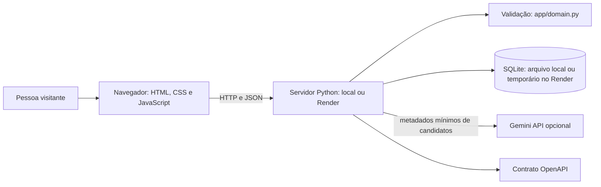

# Plano técnico — 001-achados-e-perdidos

**Estado:** proposta técnica para execução local e demonstração pública acadêmica. A publicação ainda não foi realizada; não requer aprovação do professor.

## Contexto e restrições técnicas

- **Linguagem e execução:** Python 3.9 ou superior, usando a biblioteca padrão; não há dependências Python externas.
- **Interface:** HTML, CSS e JavaScript nativos em `app/index.html`, `app/styles.css` e `app/main.js`.
- **Servidor e API:** `app/server.py`, com `http.server`, serve a interface e a API JSON. Localmente escuta em `127.0.0.1:8000`; aceita host e porta por argumentos, permitindo que o Render use `0.0.0.0` e a variável `PORT`.
- **Sugestões de correspondência:** `POST /api/v1/items/{id}/matches` compara anúncios abertos de tipos opostos. O servidor pontua localmente título, categoria, local, descrição e proximidade da data; se `GEMINI_API_KEY` existir, envia metadados limitados ao Gemini para reordenar os candidatos. O fallback local funciona sem chave ou se o provedor falhar.
- **Domínio:** `app/domain.py` valida os campos e regras dos anúncios antes da persistência.
- **Persistência:** SQLite; tabelas `listings` e `app_meta`. O caminho padrão local é `%LOCALAPPDATA%/CESMAC-AchadosPerdidos/items.sqlite3`; `LOST_FOUND_DB` permite configurar outro arquivo. No Render gratuito, o arquivo fica em `/tmp` e é temporário.
- **Contrato:** [`contracts/openapi.yaml`](contracts/openapi.yaml), servido em `GET /openapi.yaml`.
- **Limites operacionais:** requisição de até 1.000.000 bytes; listagem de até 200 anúncios. Fotos são preparadas no navegador e armazenadas com o anúncio.
- **Ambientes da demonstração:** execução local no Windows/Chrome e publicação acadêmica no Render, configurada em `render.yaml`. O deploy e o teste externo da URL ainda estão pendentes.

## Arquitetura e responsabilidades

- O navegador apresenta o mural, coleta os dados do formulário, permite busca e filtros e aciona o contato informado.
- O servidor verifica entradas independentemente das validações da interface, aplica permissões do código de gerenciamento e persiste os dados.
- O SQLite mantém anúncios e marcadores de seed demonstrativo. O seed acrescenta registros fictícios ausentes e preserva publicações da comunidade. Exemplos genéricos ficam resolvidos; contatos autorizados são carregados de `data/local-demo-contacts.json`, arquivo local ignorado pelo Git, e apenas seus cartões de demonstração ficam abertos.
- `is_demo` separa cenários de demonstração das publicações feitas pelo formulário. O filtro de origem atua na interface; os cartões mostram rótulos de “Exemplo fictício” ou “Publicação da comunidade”, sem afirmar que uma pessoa ou relato foi verificado. Contatos reais em cenários fictícios só entram com autorização explícita e continuam identificados como exemplos.
- A edição de foto pela interface fica restrita à execução local: cartões demonstrativos e o cartão autorizado “Mochila preta” de Christian Lopes. O servidor verifica o endereço de loopback e a identidade permitida do anúncio antes de gravar a imagem.
- A análise busca até 200 anúncios abertos do tipo oposto, calcula pontuação local e considera no máximo 20 candidatos para Gemini. O provedor recebe somente ID, tipo, título, categoria, local e data, nunca nomes, descrições, fotos, e-mails, telefones ou códigos de gerenciamento. A resposta é validada contra IDs existentes; sem Gemini, a pontuação local mantém o recurso disponível.
- Cada IP pode solicitar até oito análises por minuto. A interface explica que a sugestão é incerta e deve ser confirmada diretamente com a pessoa que publicou.
- Após publicar, a confirmação solicita sugestões automaticamente e mostra os resultados na própria janela. Cada candidato inclui razões calculadas localmente (categoria, palavras, local e data); as respostas “Pode ser”/“Não é meu item” ficam em `localStorage` e não são usadas para treinar o provedor.
- A tela separa filtro de tipo e filtro de situação. Resolver com o código válido ativa a aba “Resolvidos”; os anúncios perdidos usam vermelho, encontrados amarelo e resolvidos verde.
- O contrato define caminhos, parâmetros, limites, respostas e erros da API. Mudanças da API devem atualizar contrato, testes e documentação.

## Decisões técnicas e alternativas

| Questão | Escolha atual | Alternativas consideradas | Motivo e consequências | Rever quando |
|---|---|---|---|---|
| Servir interface e API | Um servidor Python da biblioteca padrão, local e no serviço Render | Framework Python; interface e API em processos separados | Evita instalar dependências e simplifica o protótipo. A instância é apenas para demonstração acadêmica; não é recomendada para operação pública de produção. | Antes de uso real, se houver necessidade de autenticação, disponibilidade ou segurança operacional. |
| Persistir anúncios | SQLite local; no Render gratuito, arquivo temporário | PostgreSQL gerenciado; disco persistente pago | Mantém execução local simples e permite demonstrar a aplicação sem cobrança planejada. Na nuvem gratuita, anúncios e fotos podem desaparecer quando o serviço reiniciar/desligar. | Se o grupo exigir preservar dados na nuvem, revisar custo e migrar a persistência. |
| Correspondências | Pontuação local e reordenação opcional por Gemini `generateContent` via HTTPS | Apenas algoritmo local; usar Gemini obrigatório; SDK externo | O mural continua funcional sem credenciais; Gemini pode reconhecer relações semânticas entre anúncios. A chave permanece no servidor e só metadados básicos são enviados. A pontuação é indicativa, não probabilidade nem confirmação. | Se quotas, custo, modelo ou privacidade deixarem de atender ao grupo. |
| Origem dos anúncios | Reutilizar `is_demo` para filtros e rótulos | Criar um campo de origem novo | O banco já distingue seed de publicações de formulário. “Comunidade” descreve a origem técnica; não significa que o sistema verificou a pessoa ou o relato. Os cartões com contato local recebem um rótulo específico que separa item fictício de número real. | Se a equipe adicionar autenticação ou moderação. |
| Gerenciar publicação sem conta | Código aleatório, armazenado no cliente e como hash no servidor | Contas com autenticação; links de recuperação | Mantém o escopo pequeno; perder o código impede gerenciar o anúncio. Não comprova identidade ou propriedade. | O grupo aprovar contas ou recuperação de acesso. |
| Armazenar foto | Dados da imagem junto ao registro | Arquivos em diretório separado | Simplifica a persistência local; aumenta o tamanho do banco, por isso existem limites de corpo e de imagem. | O tamanho/quantidade de imagens se tornar incompatível com a demonstração. |

Essas escolhas descrevem a implementação atual e precisam ser revisadas pelo grupo. Não são requisitos de produto aprovados por si só.

## Estratégia de verificação

Os testes usam dados fictícios e banco temporário. Nunca devem ler ou modificar o banco real em `%LOCALAPPDATA%`.

1. **Domínio (`tests/test_domain.py`):** campos obrigatórios, categorias, tipos, limites, telefone de 30 caracteres, data futura, contato, urgência e formatos/tamanho de foto.
2. **API e persistência (`tests/test_http_api.py`):** fluxo P1 de criar, listar/localizar e devolver o contato; filtros válidos/inválidos; health e OpenAPI; erros; código de gerenciamento; foto; persistência após reinício.
3. **Interface (`checklists/acceptance-manual.md`):** executar a jornada P1 no Chrome, registrar versão e conferir as larguras 360, 768 e 1366 px; contatos reais de demonstração somente com autorização explícita.
4. **Contrato e links:** conferir caminhos, enumerações, limites e status de erro contra servidor e documentação.
5. **Correspondências:** verificar após publicar e pela ação do cartão, limite de três, razões, lista vazia, avaliação local, ID real e navegação. Com Gemini, conferir que só ID/tipo/título/categoria/local/data são enviados; testar sem chave e serviço indisponível para confirmar o fallback local. Não registrar nem colar a chave em evidências.
6. **Situação e cores:** filtrar todos, em aberto e resolvidos; verificar que os cartões abertos aparecem antes da seção verde de resolvidos e que a seção some quando o filtro está em aberto. Verificar marcação verde ao concluir anúncio próprio com token válido. Não permitir resolver anúncio alheio sem código.

Uma tarefa só é concluída com evidência do resultado descrita em `tasks.md`; a existência do código não é evidência suficiente. A execução automatizada depende de uma instalação Python acessível. O roteiro visual exige execução no Chrome do ambiente do grupo.

## Riscos e respostas

| Risco | Efeito | Resposta |
|---|---|---|
| Código de gerenciamento perdido | A pessoa não consegue alterar a publicação. | Exibir após criar e oferecer importação manual; recuperação permanece fora do escopo. |
| Contato exposto no mural | Visitantes veem o meio informado; números reais em cenários demonstrativos podem receber mensagens indevidas. | Usar contatos fictícios por padrão; números reais só com autorização explícita e rótulo de cenário fictício. |
| Serviço parado, em inicialização ou porta ocupada | Interface não consulta a API ou o primeiro acesso demora. | Rota de saúde; instrução local; no Render gratuito, informar que o serviço pode iniciar sob demanda. |
| Contato ou anúncio pessoal exposto na nuvem | Visitantes públicos podem consultar o mural e os contatos informados. | Publicar apenas cenários fictícios e contatos autorizados; nunca enviar o banco local do grupo para o GitHub/Render. |
| Provedor de IA indisponível, quota excedida ou chave ausente | A ordenação semântica por Gemini fica indisponível. | Usar a pontuação local; mural e sugestões permanecem disponíveis. A chave é opcional, fica somente no ambiente secreto do servidor e nunca no JavaScript ou Git. |
| Correspondência incorreta ou envio de informação pessoal | Pessoa pode procurar item errado ou expor dados. | Mostrar linguagem de possibilidade, validar IDs existentes e não enviar contato, nome, descrição, foto ou código ao Gemini. A confirmação fica com as pessoas envolvidas. |
| Perda de dados na hospedagem gratuita | Anúncios e fotos podem sumir após restart, deploy ou suspensão. | Documentar como limitação aceita da demonstração; não prometer persistência na nuvem gratuita. |
| Imagem grande | Aumenta requisição e banco. | Compactar no cliente e impor limites na interface, domínio e servidor. |
| Seed duplicado ou perda de anúncio real | Demonstração confunde usuários ou remove dados. | Seed incremental com identificadores e sem apagar registros existentes. |

## Atendimento à constituição

| Princípio | Decisão e evidência esperada |
|---|---|
| Relatos transparentes | Cartões exibem dados informados e não alegam verificar identidade/propriedade; conferência em SC-01. |
| Privacidade por padrão | Seed usa cenários fictícios; contatos reais nos exemplos exigem autorização explícita e identificação como demonstração. Contatos publicados são públicos. A análise Gemini usa somente metadados básicos de anúncios e exclui descrição, nomes, fotos, contatos e códigos. |
| Controle da publicação | Código imprevisível, hash no banco e autorização em PATCH/DELETE; testes de token correto/incorreto. |
| Validação no servidor | Domínio e API rejeitam entradas inválidas mesmo sem validação do navegador; testes unitários e HTTP. |
| Documentação acompanha o código | Alterações de comportamento atualizam spec, contrato, tarefas e roteiro; revisão de convergência. |

## Limites desta proposta

O incremento é um protótipo para execução local e uma demonstração pública acadêmica no Render. Não inclui contas, verificação de identidade, moderação, denúncias, notificações, recuperação de código, backup automático ou disponibilidade de produção. O Render gratuito é temporário para os dados; a URL pública só pode ser registrada após deploy e validação externos.
